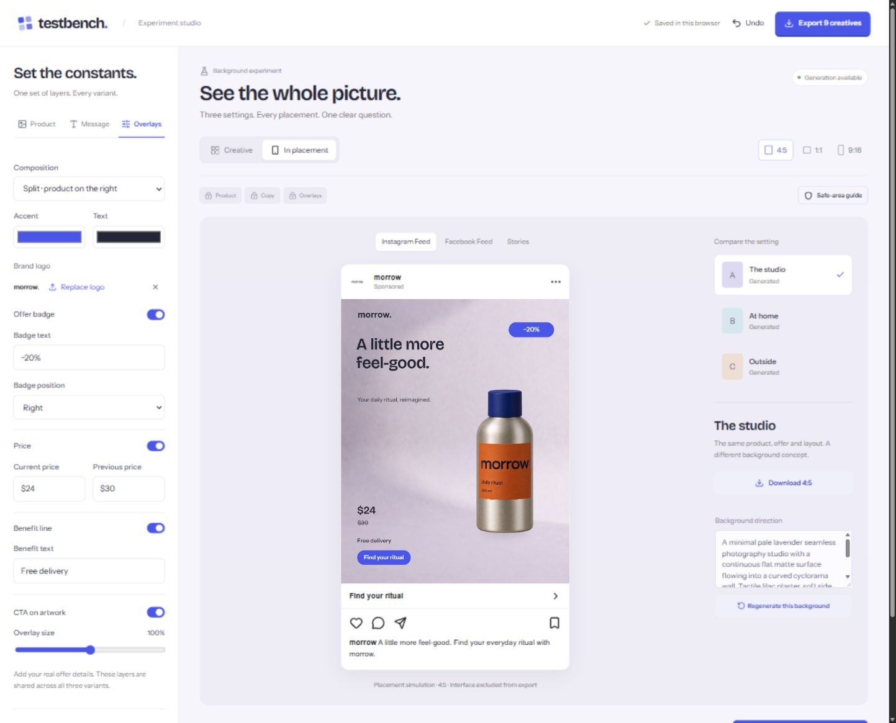

# TestBench

**One product. One variable. A creative experiment worth running.**

[**Open the interactive demo →**](https://muhamed-kanapiya.github.io/testbench/) · [Experiment studio](https://muhamed-kanapiya.github.io/testbench/studio/) · [Connect your Meta API](#run-locally-with-your-own-meta-api-key)

TestBench helps performance marketers and small brands prepare comparable ad creatives. Choose a background, product composition, headline or artwork CTA experiment, then compare A/B/C while keeping the other elements fixed.

Built for **Build for Your World** at the Meta AI Developer Hackathon.



## Try the public demo

**No account, API key or installation required.** The GitHub Pages demo uses bundled example images and curated copy. It makes no Meta API requests and does not simulate live generation.

1. Choose **Background**, **Product composition**, **Headline** or **Call to action**.
2. Edit your message, composition, logo, colours, offer badge and price overlays.
3. Preview 4:5, 1:1 and 9:16 creatives in Instagram Feed, Facebook Feed and Stories simulations.
4. Download a PNG or export all **nine creatives**, the product layer and the experiment brief as a ZIP.

Headline and CTA modes start with three different editable examples. Sample buttons restore curated assets or copy; they are labelled accordingly. You can also upload your own transparent product PNG and logo. These files stay in your browser. Automatic background removal and AI generation require the local API version.

| Capability | Public demo | Local app with your Meta key |
| --- | --- | --- |
| Four experiment modes, editing and placement previews | Included | Included |
| PNG / nine-creative ZIP export | Included | Included |
| Browser autosave and session Undo | Included | Included |
| Product input | Included example or transparent PNG | PNG, JPG or WebP; SAM cutout |
| Backgrounds | Bundled examples | Muse Image generation |
| Headline / CTA alternatives | Curated examples or manual edits | Muse Spark suggestions or manual edits |
| Hypothesis | Editable example | Muse Spark suggestion, editable |

The public site is static. **It does not accept or store API keys.** To try real AI requests, run the app locally using the instructions below.

## Run locally with your own Meta API key

Requires **Node.js 22.9+** and an account with access to the Meta Model API models used below.

```sh
git clone https://github.com/muhamed-kanapiya/testbench.git
cd testbench
npm ci
```

Copy `.env.example` to `.env.local` using your editor, then add your own key:

```dotenv
MODEL_API_KEY=your_meta_model_api_key
```

Keep the key server-side in `.env.local`, which is excluded from Git. Never put it in a `NEXT_PUBLIC_` variable or a browser form.

```sh
npm run dev
```

Open the Local URL printed by Next.js. The landing page is `/`; the editor is `/studio`. The studio shows **Generation available** when the server has a key configured. Successful generation also depends on valid access, quota and model availability.

For a first live test, keep the example product, choose Background and click **Generate three backgrounds**. Then try Headline or Call to action to generate B/C alternatives. For product extraction, upload a photo and describe its visible object with a simple noun such as `bottle`, `box` or `shoe`; review and approve the cutout before use.

You can run the local app without a key to explore the included images and manual editing. Live generation remains unavailable. To preview exactly the public demo, use `build:pages` below.

```sh
npm run typecheck
npm run build
npm start
```

The dev/start commands bind to loopback. A public deployment of the full API version needs a server host and appropriate access controls. GitHub Pages only hosts the static demo.

If your network uses a Windows-trusted inspection certificate, provide its trusted CA bundle through `NODE_EXTRA_CA_CERTS` when starting Node; keep certificate verification enabled.

## How Meta powers the full app

| Model | Role |
| --- | --- |
| `sam-3.1` | Product segmentation over the streaming Responses API; masks decoded with the official `@meta-sam/parser` |
| `muse-image-1.0` | Background generation, separate from the unchanged foreground product |
| `muse-spark-1.3` | Headline and CTA alternatives, plus an editable experiment hypothesis |

Requests use Standard model IDs at `https://api.meta.ai/v1`, with API response storage disabled in application requests. Server routes validate images and requests and apply an in-process rate limit. Canvas handles composition and PNG rendering; JSZip packages the export. The current integration targets **Meta Model API**, not arbitrary AI providers.

## What an export contains

- Three PNG variants in each format: **1080 × 1350**, **1080 × 1080** and **1080 × 1920**.
- The source product cutout and optional logo.
- `experiment.json`: selected variable, controlled elements, wording and asset provenance, overlay settings, caption, per-variant transforms and product SHA-256.
- A short guide for setting up a randomized split test.

Blank/repeated wording, repeated composition presets and text overflow block export with an actionable message. Headlines share one font size across A/B/C within a format; CTA button geometry stays fixed when testing its wording. Backgrounds are cropped rather than outpainted. Guides and placement interface frames never appear in exported PNGs.

## Build and deploy the static demo

```sh
npm run build:pages
npm run preview:pages
```

Open `http://127.0.0.1:3212/testbench/`. The build creates `out/` with `NEXT_PUBLIC_DEMO_MODE=true` and the `/testbench` base path. It builds an isolated source copy without API routes, server API code or `.env` files, so the local development app is not interrupted.

The [Pages workflow](.github/workflows/pages.yml) builds and deploys `out/` on pushes to `main`. In your fork, enable **Settings → Pages → Source → GitHub Actions** and adjust `NEXT_PUBLIC_BASE_PATH` in the workflow if your repository has a different name. Use an empty base path for a site hosted at the domain root. No Meta key or additional deployment secret is needed by this workflow.

## Scope and data

TestBench prepares creative experiments. It does **not** run ads, predict CTR, choose a winner or establish statistical significance. Compare variants within the same placement and format using a randomized split test with consistent targeting, destination, schedule and optimization.

Background tests vary a complete concept, which can include colour, light and props together. Composition tests vary position and size together. CTA tests change wording inside the image; the native placement button and caption stay shared. Placement frames are simulations, and composition guides are design margins rather than official approval checks. Review the final placement in Ads Manager. Stories previews and exports are static images, not videos.

One project is autosaved in IndexedDB in the current browser and origin. The demo uses separate draft storage from the full app. Undo keeps up to 25 changes in the current session. Wait for **Saved in this browser** before closing; export a kit for a separate copy. Multiple-tab editing is unsupported. Clearing browser data removes the saved draft. There are no accounts, cross-device sync or hosted project storage. The page loads fonts from Google Fonts; product and logo uploads in demo mode are processed locally.

## Example asset provenance

Morrow is a fictional brand. Bundled example images were created with the built-in imagegen tool, **not** returned by a live Meta request. Copy examples are curated. The editor and export manifest distinguish examples, manual edits and Meta-generated content. See [ASSETS.md](ASSETS.md) for asset details.

## Validation

The full prototype has been checked with TypeScript and a production build, live SAM extraction, Muse Image backgrounds and Muse Spark copy/hypotheses. Browser checks covered editing, draft restoration, Undo, overlays, placement previews and nine-image exports. Prior export checks verified dimensions, product hashes, variable isolation and consistent CTA bounds.

The static demo is built separately with no API routes. Its release checks include base-path asset loading, ready-to-edit wording examples, browser-only uploads, autosave, placement previews and export.

## Contact

Built by **Muhamed-Kanapiya Zhaksylyk**.

- [Telegram](https://t.me/muhamed_kanapiya)
- [Email](mailto:muhamedkanapiya@gmail.com)
